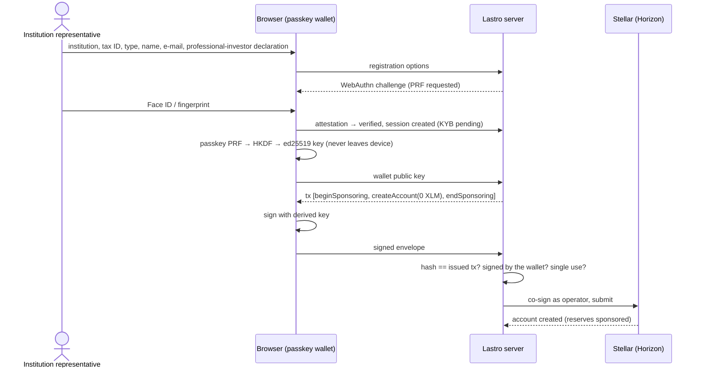
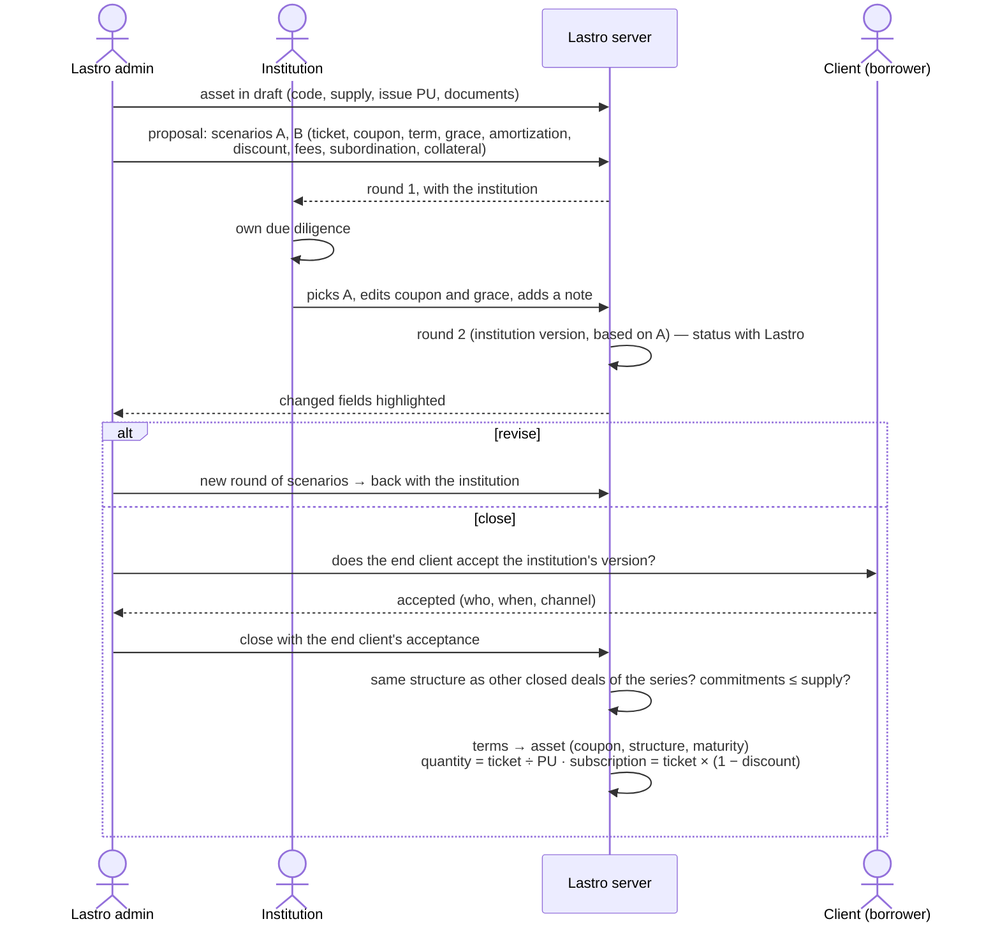
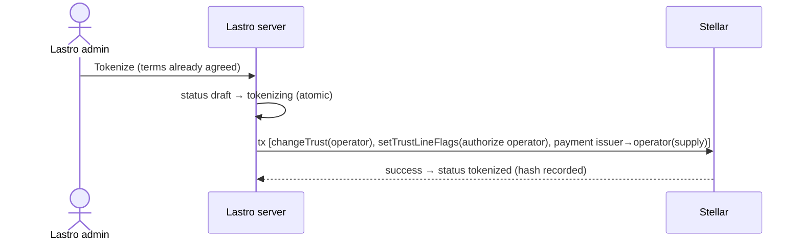
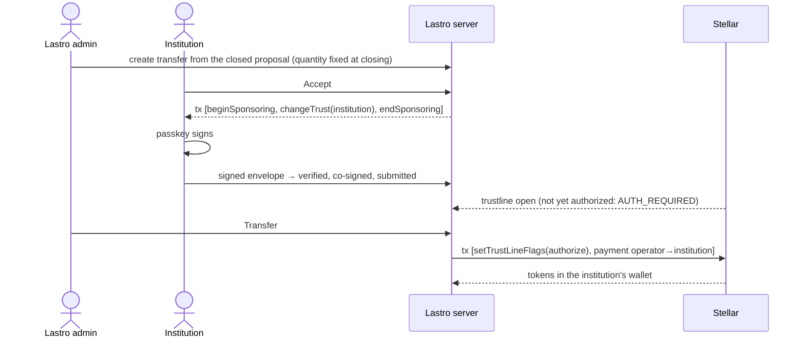
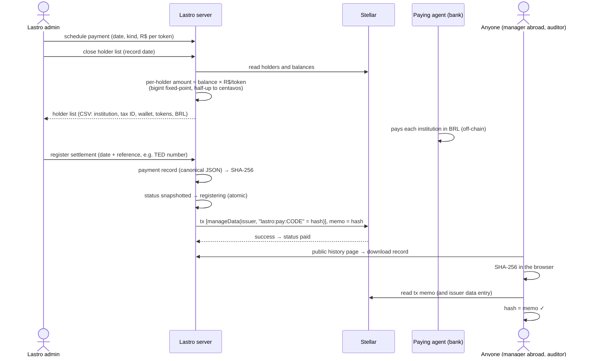
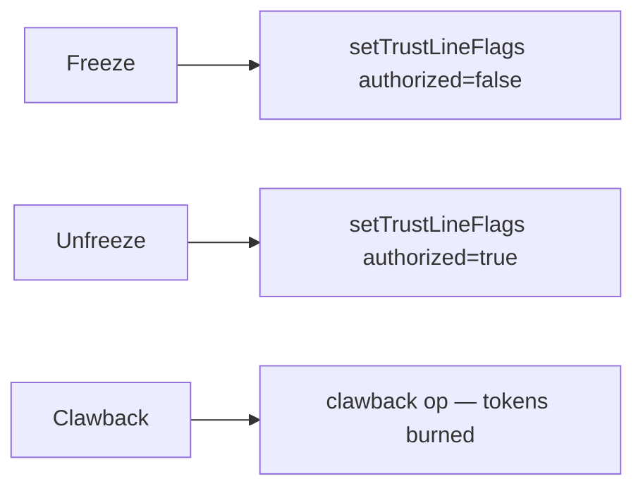
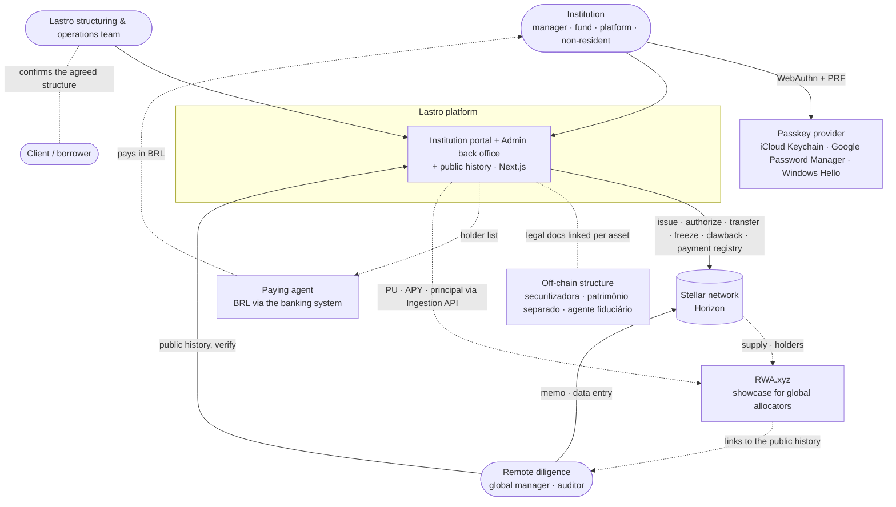
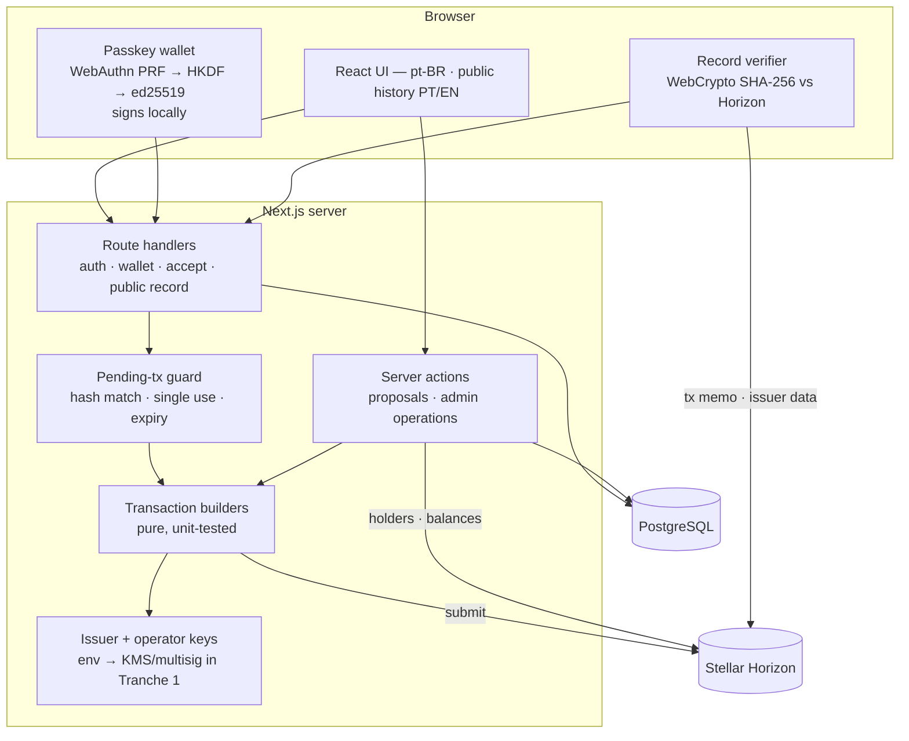

# Lastro — Technical Architecture

> Stellar Community Fund · Build Award submission · field 13 (Technical Architecture)
> Structure follows the *Stellar KickStart — Technical Architecture* template.

**Contents**
1. [Introduction](#1-introduction) — overview, definitions, constraints
2. [Architecture overview](#2-architecture-overview) — flows, C4 L1, C4 L2
3. [Stellar asset & account model](#3-stellar-asset--account-model) (in place of “Contract overview”: Lastro uses no smart contracts)
4. [Technology stack](#4-technology-stack)
5. [Integrations](#5-integrations)
6. [Security model](#6-security-model)
7. [Roadmap](#7-roadmap)

---

## 1. Introduction

### 1.1 High-level overview

Lastro is an **originator and structure architect** for Brazilian private credit: corporate credit, CRI and real-estate development, legal claims, tax credits. It works **B2B only**. Its buyers are institutions (asset managers, funds, family offices, investment platforms, and foreign managers investing under the non-resident regime known as "4.373"). Lastro does not compete with investment platforms; it supplies them. Every deal is structured through a *securitizadora*, a segregated estate (*patrimônio separado*) and a fiduciary agent. Lastro puts that operation on Stellar:

- **Each deal's structure is designed with the institution that buys it.** Lastro proposes capital structure scenarios: ticket (face value), coupon, term, grace period, amortization, discount and fee design, mezzanine and subordinated risk allocation, and embedded collateral. The institution runs its own diligence, edits one scenario and sends it back. Lastro either confirms with the end client (the borrower) that it accepts the institution's version, and closes, or answers with a new round. Closing writes the agreed terms to the asset and fixes the institution's token quantity and subscription amount.
- **Each deal becomes a Stellar asset** (e.g. a CR, *Certificado de Recebíveis*) issued by Lastro's issuer account.
- **Compliance lives in the asset.** The issuer sets `AUTH_REQUIRED`, `AUTH_REVOCABLE` and `AUTH_CLAWBACK_ENABLED`. Only accounts Lastro has authorized after KYB can hold the token, and Lastro can freeze a holder or claw back tokens (court order, lost device). The Stellar protocol enforces these controls, and anyone can see them on a block explorer.
- **Institutions need no crypto setup.** The institution's representative gets a Stellar account whose key is derived **on their device from a passkey** (WebAuthn PRF). No seed phrase, no browser extension, no XLM: Lastro sponsors the account reserves and pays every fee.
- **Acceptance is explicit.** The institution accepts a closed deal by opening a trustline, signed with the passkey. Lastro then authorizes it and transfers the tokens from its treasury.
- **Cash moves off-chain; the payment history is on-chain and public.** The paying agent pays coupons and amortization in BRL, through the banking system. On the record date Lastro closes the holder list from on-chain balances, which fixes each holder's amount. After settlement Lastro registers the payment on Stellar: the SHA-256 of the payment record goes into a transaction memo and into a data entry on the issuer account. The record holds the holder list, per-holder amounts and the off-chain settlement reference. Each asset has a **public history page** where anyone (a manager abroad, an auditor, an RWA.xyz visitor) can recompute the hash in their own browser and check it against Horizon.
- **Professional investors only.** No retail: each CR is offered only to institutions Lastro onboards. There is no individual suitability and no crowdfunding platform. If a buyer resells smaller units on its own platform, that is the buyer's decision and under its own rules. The offer to professional investors is subject to legal review.

The proof of concept described here runs end-to-end on Stellar testnet; see `tests/e2e/poc.spec.ts` and `scripts/testnet-smoke.ts`.

**Takeaways**
- Classic Stellar assets with issuer authorization flags are the compliance layer — no smart contracts to audit or upgrade.
- The structuring loop and the public payment history are the product: one is how deals close with institutions, the other is how a remote manager diligences them.
- Lastro operates two accounts (issuer + operator); institutions hold their own keys.

### 1.2 Definitions, acronyms and abbreviations

| Term | Definition |
|---|---|
| **CR** | *Certificado de Recebíveis* — receivables certificate issued by a securitizadora (Law 14.430/2022). |
| **CRI / CRA** | Real-estate / agribusiness receivables certificates. |
| **CCB** | *Cédula de Crédito Bancário* — bank credit note. |
| **Securitizadora** | Brazilian securitization company that issues the certificates. |
| **Patrimônio separado** | Segregated estate: the receivables backing one issuance, ring-fenced from the securitizadora's own balance sheet. |
| **Agente fiduciário** | Fiduciary agent representing the holders. |
| **End client (borrower)** | The company whose credit backs the deal (e.g. Kalata). Lastro confirms it accepts the institution's version before closing. |
| **Institution** | The buyer: asset manager, fund, family office, investment platform, bank, insurer/pension fund, or non-resident investor. Represented in the app by a named representative. |
| **Professional investor** | *Investidor profissional* (CVM Resolution 30). Lastro serves only professional investors; the representative declares it at sign-up and Lastro checks it in KYB. |
| **Proposal / scenario** | A structuring negotiation with one institution. Each round adds scenarios (ticket, coupon, term, grace, amortization, discount, fees, subordination, collateral); nothing is edited in place. |
| **Discount (deságio)** | Discount on face value: the institution receives `ticket ÷ PU` tokens and pays `ticket × (1 − discount)` in BRL, off-chain. |
| **Subordination** | The mezzanine / subordinated risk allocation of the structure (e.g. a 20% subordinated tranche retained by the originator). |
| **PU** | *Preço unitário* — unit price (mark) of one token, in BRL. |
| **Private placement** | *Oferta privada*: the CR is offered only to institutions Lastro onboards directly, with no public offering. |
| **Paying agent** | The party that pays coupons and amortization in BRL to holders, off-chain, on behalf of the segregated estate. |
| **Record date** | *Data de corte*: the moment the holder list of a payment is closed from on-chain balances. |
| **Payment record** | Canonical JSON of one payment event: asset, amount per token, holder list with per-holder amounts, off-chain settlement date and reference. Its SHA-256 is registered on Stellar. |
| **4.373** | Market shorthand for the non-resident investment regime (CMN Resolution 4.373, replaced from Jan 2025 by BCB/CVM Joint Resolution 13/2024). |
| **KYB / AML** | Know Your Business / Anti-Money Laundering: the institution's onboarding review. |
| **LGPD** | *Lei Geral de Proteção de Dados* — Brazil's data protection law (GDPR-like). |
| **Issuer account** | The Stellar account that creates every Lastro asset and controls authorization flags. |
| **Operator account** | Lastro's treasury: receives the issued supply, distributes it, pays fees and sponsors institution reserves. |
| **Trustline** | A Stellar account's explicit opt-in to hold a given asset. In Lastro, creating it = the institution accepting the closed deal. |
| **AUTH_REQUIRED / AUTH_REVOCABLE / AUTH_CLAWBACK_ENABLED** | Issuer flags: holders need issuer authorization; the issuer can revoke it (freeze); the issuer can claw back balances. |
| **Sponsored reserves (CAP-33)** | Protocol feature that lets one account pay the XLM reserve of another account's ledger entries. |
| **Passkey / WebAuthn** | Phishing-resistant credential stored in the device or password manager (iCloud Keychain, Google Password Manager…). |
| **PRF extension** | WebAuthn extension that returns a secret only that passkey can produce for this site; Lastro derives the institution's Stellar key from it. |
| **Horizon** | Stellar's HTTP API used to submit transactions and read accounts/balances. |
| **Memo hash / data entry** | A 32-byte value attached to a transaction; a key/value pair stored on a Stellar account (`manageData`). |

### 1.3 Architecture constraints

**Regulatory**
- Every deal is structured off-chain (securitizadora + patrimônio separado + fiduciary agent). The token is the on-chain representation of the institution's position; the legal documents are linked from the asset record. **The token complements, and does not replace, the official book entry** kept by the registrar (*escriturador*); Tranche 2 reconciles the ledger with it.
- **Institutions only.** Each CR is a private placement to professional investors Lastro has onboarded, with no public offering, no retail and no crowdfunding platform. Foreign managers invest under the non-resident regime (4.373). The offer route is subject to legal review. The back office enforces these rules *before* any authorization is granted on-chain:
  - only KYB-approved institutions receive scenarios;
  - a delivery exists only for a proposal closed with the borrower;
  - the closed commitments of a series cannot exceed its supply.
- **No cash on-chain.** Subscriptions, coupons and amortization settle in BRL through the banking system. Stellar holds ownership and the record of every payment event.
- Only KYB-approved institutions may hold a token → enforced on-chain by `AUTH_REQUIRED` (an unauthorized trustline cannot receive the asset).
- Lastro must be able to execute court orders and recover positions → `AUTH_REVOCABLE` (freeze) and `AUTH_CLAWBACK_ENABLED` (clawback).
- LGPD: no personal data on-chain. The ledger holds only addresses and balances. Institution names, tax IDs, representatives and KYB status stay in Lastro's database.

**Security**
- Keys never leave the representative's device and are never stored: every signature re-derives the key from the passkey.
- The server co-signs a client-signed transaction only if it is **byte-for-byte the transaction the server built** (hash match against a single-use, expiring record), so a client can never make Lastro's operator sign anything else.
- Every on-chain action that moves or creates tokens, or registers a payment, is guarded by an atomic status transition (no double issuance / transfer / registry) and has a bounded validity window so an uncertain submission can always be reconciled. The structuring loop uses the same pattern: every round is a conditional update on the proposal's status and round number.

**Technical**
- Stellar classic only — **no smart contracts**. Smallest audit surface, protocol-native compliance controls, regulator-legible.
- Institutions must not need XLM: account creation and trustlines are sponsored (CAP-33); fees are paid by the operator.
- Public, MIT-licensed code (SCF requirement).

**Takeaway:** the design is shaped by an institutional private placement, self-custody without crypto UX, off-chain cash, and a payment history anyone can verify remotely.

---

## 2. Architecture overview

| Component | Responsibility |
|---|---|
| **Institution portal** (`/app`) | Institutional sign-up with passkey (institution, tax ID, type, professional-investor declaration), wallet creation, structuring proposals (pick a scenario, edit, send back), accept (trustline), holdings valued at PU, payments received with their on-chain record. |
| **Admin back office** (`/admin`) | Asset registry, structuring proposals (scenarios, rounds, client confirmation, closing), KYB approval, tokenization, deliveries from closed proposals, PU marks, payment schedule, holder list for the paying agent, on-chain payment registry, freeze / clawback, on-chain monitoring, audit log. |
| **Public history** (`/historico/<CODE>`, PT/EN) | No login. Per asset: terms, on-chain controls and outstanding supply, every registered payment with its record and registry transaction, and a **Verify** button that hashes the record in the visitor's browser and checks it against Horizon. The page each RWA.xyz listing links to. |
| **API / server actions** (Next.js) | Business rules, WebAuthn verification, transaction building, co-signing and submission, reconciliation. |
| **Passkey wallet** (browser) | Derives the ed25519 key from the passkey's PRF output (HKDF-SHA256) and signs locally. |
| **PostgreSQL** | Users and institutions, credentials, assets, proposals and scenarios, allocations, prices, payments and payment records, pending transactions, audit log. |
| **Stellar network** (via Horizon) | Asset issuance, authorization, transfers, freeze/clawback, payment registry; source of truth for holdings. |

### 2.1 Flow diagrams

**Institution onboarding — passkey → Stellar wallet with 0 XLM**



**Structuring — Lastro proposes, the institution edits, Lastro confirms with the client and closes**



**Tokenization — asset registry → issued supply in treasury**



**Delivery — closed proposal → accept (trustline) → transfer**



**Payment — paid off-chain in BRL, registered on-chain, verifiable by anyone**



`sha256(record)` must equal the memo of the registry transaction and, for the latest payment of each asset, the issuer's `lastro:pay:<CODE>` data entry. The record is public: it carries wallet addresses and amounts (what the ledger already shows), never names. The page also prints the two shell commands that do the same check without the browser.

**Controls**



### 2.2 C4 L1 — system context



### 2.3 C4 L2 — containers



---

## 3. Stellar asset & account model

Lastro deliberately uses **no smart contracts**. Every control the regulated product needs exists natively in Stellar classic.

### Accounts

| Account | Holds | Flags / role | Signs |
|---|---|---|---|
| **Issuer** | nothing (issues); one `lastro:pay:<CODE>` data entry per asset | `AUTH_REQUIRED`, `AUTH_REVOCABLE`, `AUTH_CLAWBACK_ENABLED` | authorization, issuance, freeze, clawback, payment registry |
| **Operator** | issued supply (treasury), XLM for fees/reserves | sponsors institution reserves; source of every tx | every tx it sources |
| **Institution** | its tokens; 0 XLM | key derived from the representative's passkey; reserves sponsored | wallet creation, trustline (acceptance) |

### Operations per flow

| Flow | Operations | Signers |
|---|---|---|
| Issuer setup (once) | `setOptions(setFlags = 1\|2\|8)` | issuer |
| Institution wallet | `beginSponsoringFutureReserves` · `createAccount(startingBalance 0)` · `endSponsoringFutureReserves` | operator + institution |
| Accept (trustline) | `beginSponsoringFutureReserves` · `changeTrust(asset)` · `endSponsoringFutureReserves` | operator + institution |
| Tokenize | `changeTrust` (operator) · `setTrustLineFlags(authorized)` · `payment` issuer→operator | operator + issuer |
| Transfer | `setTrustLineFlags(authorized)` *(first time only)* · `payment` operator→institution | operator (+ issuer) |
| Freeze / unfreeze | `setTrustLineFlags(authorized = false / true)` | operator + issuer |
| Clawback | `clawback(from, amount)` — burned | operator + issuer |
| Payment registry | `manageData("lastro:pay:<CODE>" = sha256(record))` on the issuer · memo = same hash · no value moves | operator + issuer |

The structuring loop is off-chain on purpose: it is a negotiation between Lastro, the institution and the borrower. Its outcome reaches the ledger through the asset terms, the institution's acceptance and the transfer. Tranche 2 adds the hash of the closed proposal to the acceptance memo.

### Why classic instead of contracts

- **Protocol-enforced compliance:** an unauthorized account cannot receive the asset — no custom transfer hook that could be bypassed or mis-upgraded.
- **Verifiable by anyone:** issuer flags, each trustline's authorization and every payment registry are public ledger state.
- **Wallet & explorer compatibility:** standard assets appear correctly in every Stellar tool.
- **Smaller audit surface:** the risk concentrates in key management and the back office, both covered by the Tranche 2 security review.

### Passkey wallet derivation

```
prf    = WebAuthn.get(passkey, extensions.prf.eval.first = "lastro:stellar-wallet:v1")   // 32 bytes, device-only
seed   = HKDF-SHA256(ikm = prf, salt = "lastro:hkdf:v1", info = "stellar-ed25519-seed", 32)
wallet = Keypair.fromRawEd25519Seed(seed)                                                // G… account
```

Same passkey ⇒ same account on every device the passkey syncs to. Lastro stores only the public key. Recovery when a passkey is lost: Lastro claws back the position, re-runs KYB and reissues to the new wallet. Tranche 1 adds a second representative per institution.

---

## 4. Technology stack

**Application** — TypeScript end to end.
- **Next.js 15** (App Router, React 19 server components, server actions) — institution portal, back office, public history and API in one deployable.
- **Tailwind CSS 4** — UI.
- **@stellar/stellar-sdk 14** — transaction building, signing, Horizon.
- **SimpleWebAuthn 13** — passkey registration/authentication; PRF via the native WebAuthn API.
- **jose** — signed, httpOnly session and challenge cookies.
- **zod** — input validation; **bigint fixed-point** for every amount (7 dp tokens, 2 dp BRL, 8 dp PU).

**Data** — PostgreSQL 16 with **Drizzle ORM** and versioned SQL migrations.

**Infrastructure (target)** — containerized Next.js; managed PostgreSQL; secrets in a KMS; issuer key moved to multisig (Lastro + fiduciary agent) in Tranche 1; monitoring of operator XLM and failed submissions.

### Automated testing
- **Unit (Vitest):**
  - decimal arithmetic and rounding, and payment allocation;
  - the structuring loop: scenario parsing, changed-field detection, same-structure check, ticket → token quantity (rounded down), subscription amount after discount, maturity from the term;
  - the payment record: canonical form, hash, tamper sensitivity;
  - input validation, transaction builders (operations, sources, signers, memo), the signature guard and tamper detection;
  - the passkey derivation, checked against an independent HKDF implementation.
- **On-chain smoke (testnet):** `pnpm smoke:testnet` runs every flow — tokenize, sponsored wallet, trustline, blocked unauthorized transfer, authorize + transfer, holders, payment registry (memo and issuer data entry checked against the record hash), freeze, clawback.
- **End-to-end (Playwright):** `pnpm test:e2e` drives both profiles and an anonymous visitor in a real browser, with a virtual passkey authenticator **with PRF**, against testnet. It cross-checks Horizon after each on-chain step. It covers:
  - the full structuring loop (two scenarios with discount, fees, subordination and collateral, the institution's edit, the highlighted changes, closing with the end client's acceptance, terms and subscription amount on the asset);
  - that the record served by the app hashes to the registry memo and the issuer data entry;
  - the in-browser verification on the public page.

---

## 5. Integrations

| Integration | Use | Status |
|---|---|---|
| **Stellar Horizon** | submit transactions; read accounts, trustlines, holders; read by the visitor's browser on the public page | live (testnet) |
| **Stellar Expert** | public verification links for every transaction/account/asset | live |
| **Passkey providers** (iCloud Keychain, Google Password Manager, Windows Hello, 1Password) | WebAuthn + PRF | live (provider support matrix in Tranche 1) |
| **KYB provider** | company, beneficial-owner and AML checks feeding the KYB approval; professional-investor evidence | Tranche 1 |
| **Paying agent / bank** | settles subscriptions, coupons and amortization in BRL off-chain; settlement files reconciled against the holder list | holder list (CSV) live; statement reconciliation in Tranche 2 |
| **RWA.xyz** (Partners App + Ingestion API) | the showcase for global allocators: public listing of every mainnet asset, linked to its public history page. Supply, holders and transfers are read from the Stellar ledger. A recurring job pushes PU (price/NAV), APY, outstanding principal, payments (each with its on-chain registry tx) and loan performance. | Tranche 3 |

---

## 6. Security model

| Threat | Control |
|---|---|
| Server tricked into signing a malicious tx | co-signs only an envelope whose hash equals a server-issued, unexpired, single-use pending tx, after verifying the wallet's signature |
| Double issuance / transfer / registry (double click, retry) | atomic status transitions (`draft→tokenizing`, `accepted→transferring`, `snapshotted→registering`); uncertain outcomes are reconciled by hash after the tx's time bound |
| Two answers to the same round, or a close racing a revision | every round is a conditional update on status **and** round number; the loser gets "this proposal changed" |
| Tokens delivered without a closed deal, or twice | an allocation can only be created from a closed proposal; a partial unique index allows one live delivery per proposal |
| Two institutions closing one series on different terms, or above supply | closing checks the structure of every other closed proposal of the asset and the sum of commitments against the supply |
| Structure changed after issuance | proposals are created, revised and closed only while the asset is a draft; closing updates the asset in the same transaction, conditional on it still being a draft |
| Institution reading another institution's proposal | every institution query is scoped by its user id; the server actions check ownership and status |
| Payment record altered after the fact | its SHA-256 is on the ledger (memo + issuer data entry); any change to an amount, a holder or the settlement reference changes the hash |
| Holders change between computing and paying | the holder list is closed at the record date and stored; the paying agent pays that list and the registry commits to it |
| Token reaching a non-KYB account | `AUTH_REQUIRED`: Lastro authorizes a trustline only for KYB-approved institutions |
| Retail investor signing up | sign-up requires the institution's data and the professional-investor declaration (enforced by the API, not only the form); KYB approval gates every proposal and delivery |
| Lost passkey / court order | freeze (`setTrustLineFlags`) and clawback; reissue after KYB |
| Key theft from Lastro | impossible by design: Lastro never sees or stores institution keys |
| Phishing | passkeys are origin-bound (WebAuthn RP ID) |
| CSRF | SameSite cookies + Origin check on JSON routes; Next.js server-action origin check |
| Issuer key compromise | Tranche 1: issuer master weight → 0, multisig (Lastro + fiduciary agent), keys in KMS/HSM |
| Token mistaken for the legal ownership record | the token complements the registrar's book entry and does not replace it; Tranche 2 reconciles the holder list with the registrar before each payment |
| Personal data exposure | no PII on-chain. The public record has wallet addresses and amounts, which the ledger already shows, never names or tax IDs. The named holder list (CSV) is admin-only. LGPD-scoped database. |

---

## 7. Roadmap

| Tranche | Focus |
|---|---|
| **1 — MVP** | production-grade issuance & custody (multisig issuer, SEP-1 `stellar.toml`, burn/redemption), passkey wallet GA (provider matrix, recovery runbook, second representative per institution), compliance back office (KYB provider, professional-investor evidence, onboarding of global managers via 4,373 vehicles, AML under CVM Resolution 50, placement rules, maker-checker) |
| **2 — Testnet** | payment registry v1 & life cycle (published record schema, CLI verifier next to the public page, settlement-file and registrar reconciliation, fiduciary agent co-signing, amortization and maturity flows), closing & subscription settlement with off-chain cash (closed-proposal hash in the acceptance, reconciled transfers), testnet pilot with institutions designed to fit the CVM DLT Pilot Program + external security review |
| **3 — Mainnet** | mainnet operations, first tokenized CR (R$ 15M segregated estate) placed with institutions, every payment registered on-chain and verifiable on its public page, secondary transfers between authorized holders, RWA.xyz listing as the showcase for global allocators |
